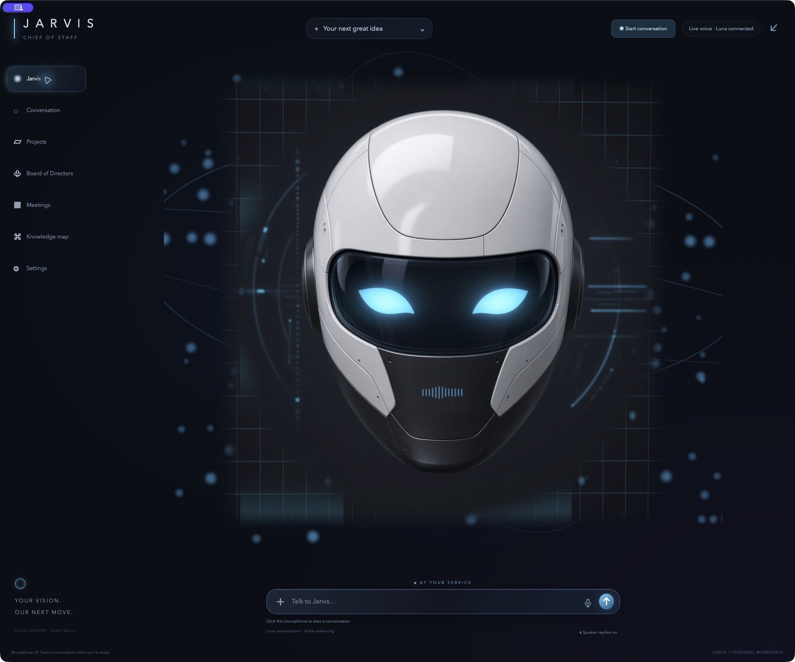
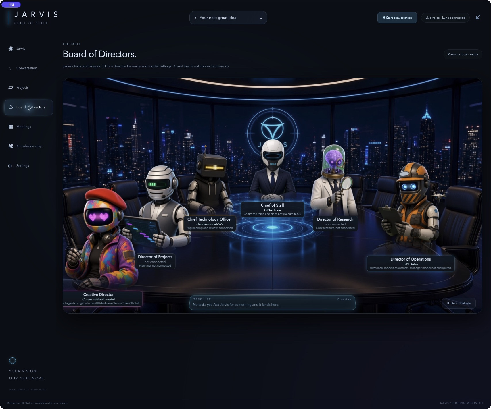

<div align="center">


# J A R V I S
### Your voice. Your vision. Your AI executive team.

**A cinematic, voice-first chief of staff for your Mac.**<br>
Brainstorm face-to-face. Bring in specialist directors. Turn the next big idea into an accountable assignment.

[](#build-your-jarvis)
[](#built-for-the-mac)
[](#a-presence-you-can-talk-to)
[](LICENSE)

[Explore the experience](#a-presence-you-can-talk-to) · [Meet the board](#your-ai-boardroom) · [Build your Jarvis](#build-your-jarvis) · [See the roadmap](#where-jarvis-goes-next)

Created and maintained by **[BeastBreaker / BB-AI-Arena](https://github.com/BB-AI-Arena)**

</div>

---

## Big ideas deserve a chief of staff

Imagine opening your Mac and talking through the business you want to build. Jarvis listens, helps sharpen the idea, and brings the right specialist into the conversation. Engineering goes to the CTO. Research goes to the Research Director. Creative work goes to the Creative Director. Work has an owner, a visible status and a place to return its results.

That is the direction of **Jarvis-Chief-Of-Staff**: a personal AI headquarters with a memorable face, a distinctive voice and the beginnings of a real executive team.

**Current priority:** one dependable loop—speak or type a request, assign a director, track the task, and open its saved result. Native adapters, task records, voice handling and Results exist in source. Provider connectivity and complete spoken delivery must be verified separately; source code and mocked tests are not proof of a working external integration.

**Experimental:** board debates, Operations workers and film Studio. Debate prompts and transcript handling have automated coverage, but a live multi-provider debate is not established by that coverage. Operations uses a configured runtime model; this README does not certify that `gpt-6-sol` is available or has completed an assignment.

New director requests use a conservative **$15 USD daily allowance for Creative and $10 USD for each other director**. Unbounded jobs are blocked. See [spending controls](docs/spending-controls.md) for supported paths and limitations, and [validation](docs/reliability-validation.md) for actual results.

## See the actual app



*Captured from the running macOS development app. This is the real interface, not a mockup.*

## A presence you can talk to

| Experience | What makes it Jarvis |
| :--- | :--- |
| 🎙️ **Voice at the center** | Streaming microphone input and spoken replies, interruption controls and a separate conversation log. |
| 🧊 **A cinematic face** | Cyan eyes, facial depth, speech-reactive lips and jaw, subtle motion and a portrait-first home. |
| 🫧 **A floating companion** | Collapse the workspace into a draggable desktop orb and return when you need the full view. |
| 🇬🇧 **A distinctive personality** | Composed British delivery, discreet assistance and restrained dry wit. |
| 🔊 **Local speech** | Kokoro voices, including **bm_lewis**, plus selectable voices and previews for team roles. |
| 🧠 **Your choice of intelligence** | Claude conversation with local British speech, Luna routing, Astra for deeper reasoning and selectable Ollama models for local conversation. |
| 🕸️ **Files you can explore** | Folder maps and Graphify code relationships with search, pan, zoom and Reveal in Finder. |

> **“Jarvis, help me think this through.”**<br>
> Start with a conversation. Move toward a clear brief, the right director and an assignment you can track.

## Your AI boardroom



*The full boardroom in the running development app: all six directors, their connection labels and the task table. Availability reflects the configuration at capture time; some seats are not connected. Screenshots show a development build and may include visual updates ahead of the published source.*

The board gives each specialist a seat, a persona and a clear responsibility. Connection indicators distinguish configured providers from seats that are still waiting for a backend.

| Seat | Responsibility | Current implementation |
| :--- | :--- | :--- |
| **Jarvis · Chief of Staff** | Conversation, clarification and delegation | Voice frontend with selectable Claude conversation, Luna/Astra routing and local conversation options. |
| **Chief Technology Officer** | Engineering judgment and technical coordination | Anthropic/Claude adapter, configurable model, native tool-call handling and bounded tool rounds. Requires a verified API connection. |
| **Director of Research** | Research and alternative perspectives | Live web research through xAI/Grok, with Claude web search as the assignment fallback when Grok is disconnected and Claude is connected. Requires a verified provider connection. |
| **Creative Director** | Design direction, naming, copy and repository work | Cursor Cloud Agents for repository work, plus a shot-planning and video-rendering pipeline with retained DARK/ComfyUI support. New production is gated, and motion rendering must use local models on DARK. Each backend requires its own configuration and access. |
| **Director of Operations** | Scoped execution and source-workspace coordination | A configured compatible runtime model can be selected for source work. Availability and successful execution of `gpt-6-sol` are unverified here; new unbounded worker launches are blocked by the spending policy. Assignments retain their manager/worker relationship in the task ledger. |
| **Director of Projects** | Planning and project coordination | Runs on a selected **Ollama model**, using the configured LAN server (DARK by default), with an optional Mac-local fallback for assignments. Produces plans and joins live board debates; its chat adapter cannot browse, edit files or run commands. |

### Experimental board debates

**Ask the board to debate a decision** by voice or use the boardroom debate control. Jarvis convenes the connected CTO (Claude), Research Director (Grok) and Projects Director (local Ollama). At least **two connected directors** are required.

1. **Directors take a position.** Each round calls the participating models in parallel with the question and the previous rounds' transcript.
2. **The board responds to itself.** Later rounds include the earlier positions so directors can challenge, refine or concede a point.
3. **A chair call assesses agreement.** The first available speaking seat, in CTO → Research → Projects order, evaluates the transcript after each round. The debate ends on reported agreement or after **three rounds**.
4. **Jarvis reports the outcome.** The boardroom displays the replies and verdict; Jarvis announces agreement, unresolved disagreement or an unusable verdict. The task ledger retains an outcome summary, chair model and debate transcript excerpt.

> **Try:** “Jarvis, ask the board whether we should launch a native Mac app first or start with a web app.”

The **Demo debate** remains available as a separately labeled, scripted animation preview. The live implementation requests provider responses; successful multi-provider operation remains unverified in this validation pass. Creative and Operations run jobs rather than chat turns, so they do not participate in the current debate loop. A model's agreement verdict is an assessment of the discussion, not independent verification of its conclusions.

### Local planning. Focused execution.

| Projects · Ollama | Operations · configured runtime |
| :--- | :--- |
| Choose a model installed on the configured Ollama server; Jarvis checks its model list before saving it. | Set the manager to `gpt-6-sol` using the compatible local agent runtime. |
| Turn a brief into milestones, responsibilities, risks and a concrete next move. | Source workers use the selected runtime manager model with `model_reasoning_effort="medium"`. |
| Planning requests use the configured Ollama endpoint, with an optional Mac-local fallback when the remote server does not answer. This director can also contribute to a debate with cloud directors. | Work uses Jarvis's source workspace and scoped SSH access to DARK, with a result report and stop control. |

The worker model follows a supported runtime manager selection. If that selection cannot run a source worker, the current fallback is Astra; a local Ollama manager does not itself execute the runtime's coding-worker protocol.

## Watch the board work

Director hand-offs and task updates appear in place. Open a director's details to see its work and recorded token usage, including daily and all-time totals by model. Usage comes from provider responses and supported worker logs; it is not a complete billing report.

The **Results** view opens saved documents and plays finished videos inside Jarvis. During video jobs, the **Studio** shows the shot plan, renderer, live ComfyUI node and sampler progress, available GPU status, and completed-shot previews. Clips are joined into a final MP4 with AVFoundation, preserving available audio.

Creative prefers **DARK's ComfyUI renderer** when its workflow is configured and the server is reachable. It can start ComfyUI over SSH using a saved start command, but cloud video fallback is not authorized; motion rendering must stay on local DARK models. The repository includes an LTX workflow test fixture; a working ComfyUI installation, model weights and an exported API workflow must be supplied separately.

## From conversation to accountable work

**Discuss → assign → track → review.**

- **Follow-ups stay bounded.** Jarvis offers at most one follow-up per request and does not chain suggestions or repeat blocked attempts.
- **Suggestions wait for approval.** A task suggested during conversation is not added to the ledger until approved. Explicit task requests can be routed directly to the relevant director.
- **Assignments have owners.** Director and worker relationships are recorded with parent task IDs.
- **State survives a restart.** The local ledger stores proposed, running, completed, failed and cancelled work, timestamps and result summaries.
- **Interrupted work stays honest.** A task left running at shutdown is marked interrupted/failed on relaunch; it does not silently become “done.”
- **You can stop active work.** Task controls target the running assignment, including supported remote-agent cancellation.
- **Source workers have a boundary.** The Operations worker is instructed to work inside Jarvis’s source workspace and report its changes and validation. It does not automatically replace the installed app.

The ledger is a foundation for dependable execution. Automatic dependency scheduling, retries, resume and independent result verification are future work.

## Built for the Mac

**Swift + AppKit · WKWebView · Three.js · Python helpers**

The native shell hosts bundled HTML, CSS and JavaScript. Three.js provides the portrait presence; Kokoro handles local speech; Graphify extracts code relationships; Ollama supplies optional local conversation models and the Projects director.

| Layer | Purpose |
| :--- | :--- |
| `Sources/Jarvis/main.swift` / `JarvisApp.swift` / `App*.swift` | CLI entry points, native lifecycle and state, with separate bridge, assignments, conversation, providers, Results, debate, video and voice modules. |
| `CloudVoice.swift` / `ConversationBrain.swift` | Streaming audio and delegated model routing. |
| `ClaudeClient.swift` / `GrokClient.swift` / `CursorClient.swift` | Specialist provider adapters. |
| `TaskLedger.swift` / `Personas.swift` | Persistent task records and bundled executive personas. |
| `BoardDebate.swift` / `OllamaClient.swift` | Live debate prompts and verdict parsing; local Projects requests. |
| `VideoPlan.swift` / `VideoRender.swift` / `DarkServer.swift` | Shot planning, ComfyUI/Grok rendering, video assembly and scoped GPU-server access. |
| `LiveUI.swift` / `ResultMedia.swift` / `TokenMeter.swift` | Live interface updates, in-app result media and recorded director usage. |
| `Frontend/presence.mjs` / `Resources/` | Portrait renderer, boardroom and application interface. |
| `scripts/voice.py` / `scripts/visemes.py` | Local speech generation and phoneme-aligned facial cues. |

API credentials are entered through native secure fields and stored in **macOS Keychain**. Keys are not passed into frontend JavaScript. Personal conversation history, indexes, caches, model weights and private runtime configuration are excluded from the public repository.

Local processing is available for selected workflows. Cloud voice and connected providers transmit the relevant audio, prompts or repository work to their services and may incur usage charges.

## Build your Jarvis

### Requirements

- Apple Silicon Mac, macOS 14 or later.
- Swift 6 command-line tools and Python 3.12.
- Node.js for frontend development and UI checks.
- Optional: Ollama and a downloaded local model.
- For Luna/Astra routing and Operations workers: a separately installed, signed-in agent runtime supporting the app-server and exec protocols.
- For cloud voice and specialist directors: your own provider credentials and appropriate service access.

Development has been checked on an **M5 MacBook Air with 32 GB unified memory**. Local model suitability depends on model size, quantization and the other applications running.

```sh
git clone https://github.com/BB-AI-Arena/Jarvis-Chief-Of-Staff.git
cd Jarvis-Chief-Of-Staff

# Optional: point to your compatible local agent runtime before building.
export JARVIS_AGENT_RUNTIME="/absolute/path/to/your/agent-runtime"

./scripts/bootstrap.sh
./scripts/build.sh
open dist/Jarvis.app
```

`bootstrap.sh` creates Python environments and downloads speech weights. If necessary, set `JARVIS_PYTHON` to your Python 3.12 executable. A private, ignored `.agent-runtime-path` file can also configure the runtime executable.

### Make it yours

1. Open **Settings** and choose your conversation brain. Claude conversation uses the configured Anthropic connection and local British `bm_lewis` speech; it reports connection failures without silently switching to another conversation model.
2. Start a conversation. Ollama provides a local conversation path, while Luna/Astra use the configured runtime. OpenAI realtime audio is a separate optional voice backend requiring its own API connection.
3. Open the board to configure the specialist providers you want to use. Select a model installed on the configured Ollama server for **Projects** and configure **Operations** only after its runtime and budget enforcement have been verified. Provider seats require their connection checks.
4. Connect at least two speaking directors—CTO, Research or Projects—then ask Jarvis to put a question to the board.
5. Select a local folder to explore its structure and available Graphify relationships.
6. Save a project brief, discuss it with Jarvis and give a connected director a concrete assignment.

### Experimental: DARK and video configuration

**Film production requires approval of the exact saved screenplay and available budget.** Motion rendering is restricted to local models on DARK. Paid planning/review and supported still-image repairs pass through the native Creative budget broker; missing broker or unknown pricing stops the request. This experimental path has regression coverage, not a completed production-film acceptance claim.

DARK is the developer's LAN GPU server. Configure your own host before using its defaults. Private settings are stored under `~/Library/Application Support/Jarvis/`:

- `dark.json`: SSH `host`, `user`, absolute `key` path and optional `comfyStart` shell command.
- `comfy-url.txt`: the ComfyUI HTTP(S) server URL on your LAN.
- `projects-fallback-model.txt`: an optional model installed in Ollama on this Mac for Projects assignment fallback.

Use **Settings → Connect DARK…** for the one-time SSH key setup in Terminal, then run the health check. This opens Terminal directly without requiring Automation permission; the server password is entered there and is not saved by Jarvis.

Place your exported ComfyUI **API-format** workflow at `~/Documents/Jarvis Workspace/Video/comfyui-workflow-api.json`. Include `{{prompt}}` in the positive prompt; `{{frames}}`, `{{seconds}}` and `{{seed}}` can supply numeric inputs. Install the workflow's required nodes and models on the server. After the exact screenplay is approved and the local renderer is ready, Creative can expose production progress in Studio; existing finished media remains available in Results. The retained Grok Imagine video adapter is blocked; it must not be used as a production fallback.

This is an ad-hoc signed development app. Helper environments and the source workspace must remain available; a self-contained, notarized installer is a future milestone.

## Development and validation

```sh
npm ci
npm run build:presence
npm run check:ui       # Fast: syntax, formatting and DOM behavior; no Swift or API calls
./scripts/check.sh      # Full native, UI and film regressions
```

Bundled frontend assets are committed, so a normal native build does not require rebuilding them with Node. The check script exercises compilation, turn detection, routing, voice activity, task records, provider parsing, debate prompts and verdicts, local Projects responses, Operations worker selection, personas, video planning and workflow handling, live progress, result media, token accounting and conversation UI behavior. These checks do not establish that every external provider is configured or available.

See [VALIDATION.md](VALIDATION.md) for earlier device and integration observations. The optional `scripts/probe_live.py` checks real cloud audio using the local Keychain credential without capturing the microphone or printing the key.

<details>
<summary><strong>Performance and animation: what has actually been measured?</strong></summary>

Two standalone API greeting probes received first audio approximately **0.75–0.79 seconds after the greeting request**. Session startup was measured separately. These are greeting probes, not a guarantee for complete spoken conversations; network, turn detection, delegation and provider load affect latency.

The portrait uses a relief mesh with image deformation rather than a fully rigged 3D head. Cloud speech uses playback activity for approximate facial motion; Kokoro supplies phoneme timing for more detailed local mouth cues. Playback, interruption and facial naturalness remain active areas of development.

</details>

## Where Jarvis goes next

The ambition is a chief of staff who can help take an idea all the way to a reviewed, working product.

- [ ] **Persistent project memory** — retrieve decisions, preferences, commitments and relevant files with source references.
- [ ] **A dependable execution engine** — dependencies, retries, restart recovery and independently verified outcomes.
- [ ] **Live-verified board debates** — connected directors, up to three rounds, a chair-assessed verdict and a saved outcome.
- [x] **Local Projects director** — planning and debate participation through an installed Ollama model.
- [ ] **Live-verified Operations model** — source workers follow the selected runtime manager at medium reasoning effort.
- [ ] **Richer executive meetings** — evidence-backed decisions, broader participation and decisions that become reviewed project plans.
- [ ] **Budget-bounded video Studio production** — shot progress, previews, in-app playback and document viewing.
- [x] **Recorded director token usage** — daily and all-time counts from supported provider responses and worker logs.
- [ ] **Smarter model economics** — measured speed, token usage and budget-aware routing, with local models handling suitable work.
- [ ] **Jarvis MCP and business tools** — scoped calendar, email and external application capabilities.
- [ ] **Concept-to-app delivery** — briefs, architecture, artwork, implementation, tests and reviewable builds.
- [ ] **Evaluated local improvement** — reviewed training examples and separate fine-tuning/evaluation workflows.
- [ ] **A distributable Mac app** — bundled dependencies, signing, notarization and a simpler first-run experience.

Saved history is already available; semantic memory and local weight training are not yet implemented. Live debates, local Projects planning, provider adapters and the task ledger are present; the complete autonomous office is still ahead.

## Follow the build

If a voice-first AI chief of staff belongs on your Mac, **star the repository** and follow the build. Reproducible bug reports and focused feature ideas help turn the vision into a dependable daily companion.

**Discoverability:** `jarvis` · `ai-assistant` · `chief-of-staff` · `macos` · `apple-silicon` · `voice-assistant` · `voice-first` · `ai-agents` · `multi-agent` · `agent-orchestration` · `local-llm` · `ollama` · `kokoro` · `text-to-speech` · `graphify` · `swift` · `threejs` · `claude` · `grok` · `cursor`

---

<div align="center">

**Built by [BeastBreaker](https://github.com/BB-AI-Arena). Built around your ambition.**

[PolyForm Noncommercial 1.0.0](LICENSE) · [Copyright notice](NOTICE) · [Third-party notices](THIRD_PARTY_NOTICES.md)

Project-authored code is available for noncommercial use under the license terms. Third-party components retain their own licenses. Jarvis is an original assistant persona and is not affiliated with Marvel or the model providers.

</div>
